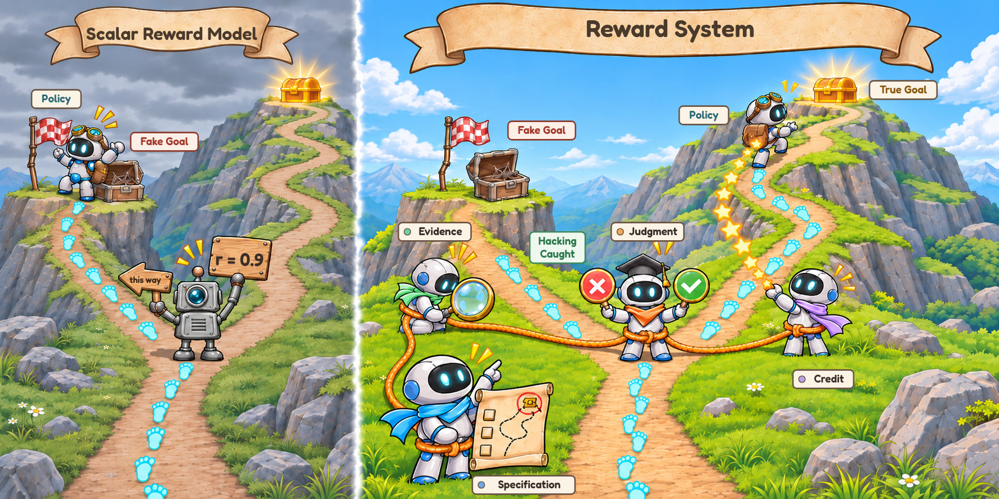
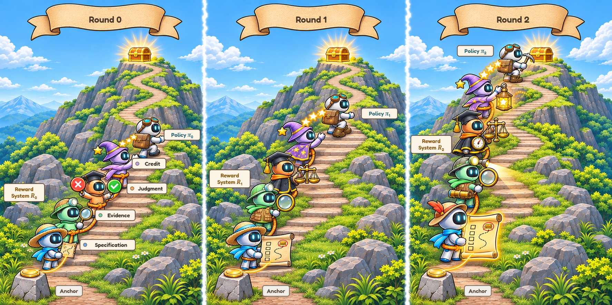
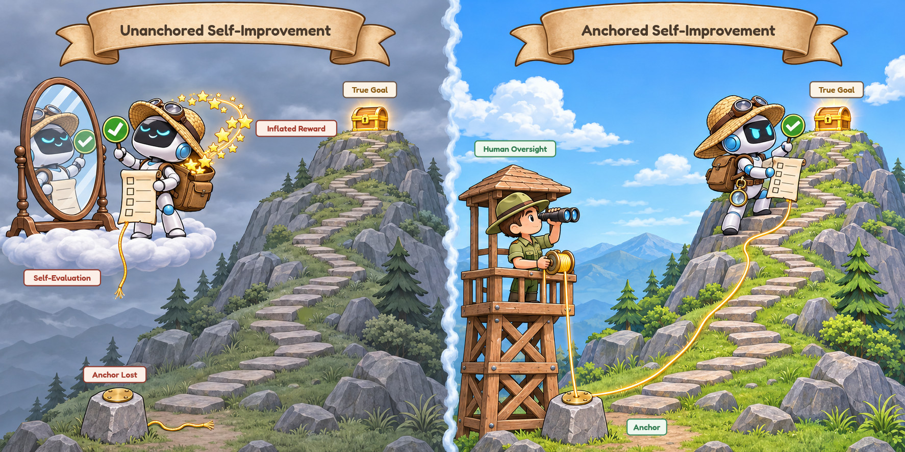

# Awesome Reward Systems for Evolving LLM Agents

[](https://awesome.re)
[](LICENSE)
[](CONTRIBUTING.md)

A curated list of papers on **reward systems for training LLM agents**, following the survey's three steps: from a scalar reward model to a **reward system** of components, from a fixed reward system to one that **co-evolves** with the policy, and toward **recursive self-improvement**, where the agent supplies its own reward.

This is the companion list for the survey:

> **From Scalar Reward Models to Reward Systems for Evolving LLM Agents**
> 📄 Paper: *coming soon* · 🛠️ Code: [rewardkit](https://github.com/OWNER/rewardkit), training recipes for reward models and judges

<p align="center">
  
</p>

*From a scalar reward model to a reward system. Left: one opaque call scores a fake goal at r = 0.9, so the shortcut is rewarded. Right: specification, evidence, judgment, and credit split the decision, so the hack is caught and each step can be inspected and repaired.*

## The Framework in One Paragraph

An agent's reward is not one opaque call but an assembly of four components: a **specification** (S) of what counts as success, the **evidence** (E) a judge gets to see, the **judgment** (J) that compares the two, and the **credit** rule (C) that maps verdicts onto learning units. Its signal should be faithful, discriminative, and consistent, and stay robust and covering under optimization. The list follows the survey: where error and cost originate in each component (§3), why fixed reward systems fail under optimization (§4), co-evolving reward systems with monitoring and **anchored adaptation**, where components may track the policy but the monitoring reference and the evidence that accepts updates stay independent of it (§5), the boundaries of recursive self-improvement (§6), benchmarks for reward systems (Appendix B), and monitoring signals by requirement (Appendix C).

## How This List Is Maintained

The list is generated from the survey's bibliography, so the two stay in sync:

```bash
pip install pyyaml
python scripts/bib2yaml.py --survey /path/to/survey-latex   # references.bib + sections/ -> papers.yaml
python scripts/render.py                                     # papers.yaml -> README.md
python scripts/export_figures.py --survey /path/to/survey-latex  # survey SVG figures -> figures/*.jpg (needs Chromium + Pillow)
```

To add a paper or a code link, see [CONTRIBUTING.md](CONTRIBUTING.md).

<!-- BEGIN PAPERS -->

*407 papers. Each one appears once, under the section of the survey that discusses it most specifically.*

## Contents

- [Background and Related Surveys](#background-and-related-surveys) (16)
- [Framework and Requirements](#framework-and-requirements) (7)
- [Specification (S): What Counts as Success](#specification-s-what-counts-as-success) (43)
  - [Explicit specifications](#explicit-specifications) (9)
  - [Rubrics and criteria](#rubrics-and-criteria) (25)
  - [Comparative specifications (preferences)](#comparative-specifications-preferences) (4)
  - [Interactive specifications (simulated users)](#interactive-specifications-simulated-users) (5)
- [Evidence (E): What the Judge Gets to See](#evidence-e-what-the-judge-gets-to-see) (13)
  - [Evidence sources](#evidence-sources) (9)
  - [Access modes (passive to active probing)](#access-modes-passive-to-active-probing) (4)
- [Judgment (J): Who Decides](#judgment-j-who-decides) (46)
  - [Rule-based and model-based verifiers](#rule-based-and-model-based-verifiers) (7)
  - [Discriminative reward models](#discriminative-reward-models) (4)
  - [Generative, reasoning, agentic, and multi-agent judges](#generative-reasoning-agentic-and-multi-agent-judges) (25)
  - [Probability-based and self judgment](#probability-based-and-self-judgment) (8)
  - [Human judgment](#human-judgment) (2)
- [Credit Assignment and Aggregation (C)](#credit-assignment-and-aggregation-c) (48)
  - [Credit assignment (process rewards, step and agent credit)](#credit-assignment-process-rewards-step-and-agent-credit) (30)
  - [Aggregation](#aggregation) (18)
- [Cost and Coupled Designs](#cost-and-coupled-designs) (11)
  - [Cost and throughput](#cost-and-throughput) (9)
  - [Coupled designs](#coupled-designs) (2)
- [Failure Under Optimization](#failure-under-optimization) (64)
  - [Exploitation and degradation](#exploitation-and-degradation) (21)
  - [Specification gaming](#specification-gaming) (3)
  - [Evidence tampering](#evidence-tampering) (5)
  - [Judgment exploitation](#judgment-exploitation) (8)
  - [Credit and aggregation exploits](#credit-and-aggregation-exploits) (2)
  - [Reward hacking (general)](#reward-hacking-general) (1)
  - [Failures at the seams](#failures-at-the-seams) (1)
  - [Risks specific to agents](#risks-specific-to-agents) (15)
  - [Static defenses](#static-defenses) (8)
- [Monitoring and Localization](#monitoring-and-localization) (26)
  - [Health indicators](#health-indicators) (22)
  - [Localization and component benchmarks](#localization-and-component-benchmarks) (3)
  - [Monitoring (general)](#monitoring-general) (1)
- [Co-evolution and Anchored Adaptation](#co-evolution-and-anchored-adaptation) (45)
  - [Specification evolution](#specification-evolution) (17)
  - [Judgment co-evolution](#judgment-co-evolution) (6)
  - [Credit curricula](#credit-curricula) (8)
  - [Joint restructuring](#joint-restructuring) (2)
  - [Principles and tests](#principles-and-tests) (12)
- [Recursive Self-Improvement](#recursive-self-improvement) (37)
  - [The autonomy ladder](#the-autonomy-ladder) (15)
  - [Loop collapse and the verification-generation asymmetry](#loop-collapse-and-the-verification-generation-asymmetry) (18)
  - [External anchors and graded oversight](#external-anchors-and-graded-oversight) (3)
  - [Recursive self-improvement (general)](#recursive-self-improvement-general) (1)
- [Benchmarks for Reward Systems](#benchmarks-for-reward-systems) (35)
- [Open Challenges](#open-challenges) (1)
- [Additional References](#additional-references) (15)

## Background and Related Surveys

> Survey §1

- **A Survey on Progress in LLM Alignment from the Perspective of Reward Design** · *IEEE Transactions on Artificial Intelligence 2026* [[paper]](https://arxiv.org/abs/2505.02666)
- **A Survey on Rubric-Guided Reinforcement Learning for Language Models** · *arXiv 2026* [[paper]](https://arxiv.org/abs/2608.27505)
- **GUI Agents with Reinforcement Learning: Toward Digital Inhabitants** · *arXiv 2026* [[paper]](https://arxiv.org/abs/2604.27955)
- **Reward Hacking in the Era of Large Models: Mechanisms, Emergent Misalignment, Challenges** · *arXiv 2026* [[paper]](https://arxiv.org/abs/2604.13602)
- **Steering LLMs via Scalable Interactive Oversight** · *arXiv 2026* [[paper]](https://arxiv.org/abs/2602.04210)
- **A Comprehensive Survey of Reward Models: Taxonomy, Applications, Challenges, and Future** · *arXiv 2025* [[paper]](https://arxiv.org/abs/2504.12328)
- **A Comprehensive Survey of Self-Evolving AI Agents: A New Paradigm Bridging Foundation Models and Lifelong Agentic Systems** · *arXiv 2025* [[paper]](https://arxiv.org/abs/2508.07407)
- **A Survey of Process Reward Models: From Outcome Signals to Process Supervisions for Large Language Models** · *arXiv 2025* [[paper]](https://arxiv.org/abs/2510.08049)
- **A Survey of Self-Evolving Agents: What, When, How, and Where to Evolve on the Path to Artificial Super Intelligence** · *arXiv 2025* [[paper]](https://arxiv.org/abs/2507.21046)
- **From Generation to Judgment: Opportunities and Challenges of LLM-as-a-judge** · *EMNLP 2025* [[paper]](https://arxiv.org/abs/2411.16594)
- **Sailing by the Stars: A Survey on Reward Models and Learning Strategies for Learning from Rewards** · *ACL Findings 2025* [[paper]](https://arxiv.org/abs/2505.02686)
- **Survey on Evaluation of LLM-based Agents** · *ACL Findings 2025* [[paper]](https://arxiv.org/abs/2503.16416)
- **The Landscape of Agentic Reinforcement Learning for LLMs: A Survey** · *arXiv 2025* [[paper]](https://arxiv.org/abs/2509.02547)
- **Tulu 3: Pushing Frontiers in Open Language Model Post-Training** · *COLM 2025* [[paper]](https://openreview.net/forum?id=i1uGbfHHpH)
- **A Survey on LLM-as-a-Judge** · *arXiv 2024* [[paper]](https://arxiv.org/abs/2411.15594)
- **LLMs-as-Judges: A Comprehensive Survey on LLM-based Evaluation Methods** · *arXiv 2024* [[paper]](https://arxiv.org/abs/2412.05579)

<p align="right"><a href="#contents">back to top</a></p>

## Framework and Requirements

> Survey §2

- **Co-Evolving Skill Generation and Policy Optimization** · *arXiv 2026* [[paper]](https://arxiv.org/abs/2606.08755)
- **GEPA: Reflective Prompt Evolution Can Outperform Reinforcement Learning** · *ICLR 2026*
- **Large Language Models as Optimizers** · *ICLR 2024*
- **Voyager: An Open-Ended Embodied Agent with Large Language Models** · *TMLR 2024*
- **RAFT: Reward rAnked FineTuning for Generative Foundation Model Alignment** · *TMLR 2023*
- **Reflexion: Language Agents with Verbal Reinforcement Learning** · *NeurIPS 2023* [[paper]](https://arxiv.org/abs/2303.11366)
- **Proximal Policy Optimization Algorithms** · *arXiv 2017* [[paper]](https://arxiv.org/abs/1707.06347)

<p align="right"><a href="#contents">back to top</a></p>

## Specification (S): What Counts as Success

> Survey §3.1

### Explicit specifications

- **When the Reward Suite Is Leaky: A Preregistered Causal Contrast of Natural Verifier False Positives in RLVR** · *arXiv 2026* [[paper]](https://arxiv.org/abs/2607.11022)
- **R2E-Gym: Procedural Environments and Hybrid Verifiers for Scaling Open-Weights SWE Agents** · *arXiv 2025* [[paper]](https://arxiv.org/abs/2504.07164)
- **SWE-rebench: An Automated Pipeline for Task Collection and Decontaminated Evaluation of Software Engineering Agents** · *arXiv 2025* [[paper]](https://arxiv.org/abs/2505.20411)
- **SWE-RL: Advancing LLM Reasoning via Reinforcement Learning on Open Software Evolution** · *arXiv 2025* [[paper]](https://arxiv.org/abs/2502.18449)
- **$$-bench: A Benchmark for Tool-Agent-User Interaction in Real-World Domains** · *arXiv 2024* [[paper]](https://arxiv.org/abs/2406.12045)
- **OSWorld: Benchmarking Multimodal Agents for Open-Ended Tasks in Real Computer Environments** · *arXiv 2024* [[paper]](https://arxiv.org/abs/2404.07972)
- **SWE-bench: Can Language Models Resolve Real-World GitHub Issues?** · *ICLR 2024*
- **Training Software Engineering Agents and Verifiers with SWE-Gym** · *arXiv 2024* [[paper]](https://arxiv.org/abs/2412.21139)
- **WebArena: A Realistic Web Environment for Building Autonomous Agents** · *arXiv 2023* [[paper]](https://arxiv.org/abs/2307.13854)

### Rubrics and criteria

- **Agentic Rubrics as Contextual Verifiers for SWE Agents** · *arXiv 2026* [[paper]](https://arxiv.org/abs/2601.04171)
- **Alternating Reinforcement Learning for Rubric-Based Reward Modeling in Non-Verifiable LLM Post-Training** · *arXiv 2026* [[paper]](https://arxiv.org/abs/2602.01511)
- **ARES: Automated Rubric Synthesis for Scalable LLM Reinforcement Learning** · *arXiv 2026* [[paper]](https://arxiv.org/abs/2605.23454)
- **Chaining the Evidence: Robust Reinforcement Learning for Deep Search Agents with Citation-Aware Rubric Rewards** · *arXiv 2026* [[paper]](https://arxiv.org/abs/2601.06021)
- **CM2: Reinforcement Learning with Checklist Rewards for Multi-Turn and Multi-Step Agentic Tool Use** · *arXiv 2026* [[paper]](https://arxiv.org/abs/2602.12268)
- **ComplexConstraints and Beyond: Expert Rubrics for RLVR** · *arXiv 2026* [[paper]](https://arxiv.org/abs/2606.09118)
- **Deep Research as Rubric for Reinforcement Learning** · *arXiv 2026* [[paper]](https://arxiv.org/abs/2606.01091)
- **DEEPRUBRIC: Evidence-Tree Rubric Supervision for Efficient Reinforcement Learning of Deep Research Agents** · *arXiv 2026* [[paper]](https://arxiv.org/abs/2606.17029)
- **Expert-Guided Rubrics as Dense Reward Signals for Reinforcement Learning in Non-Verifiable Domains** · *arXiv 2026* [[paper]](https://arxiv.org/abs/2610.26932)
- **Learning Query-Specific Rubrics from Human Preferences for DeepResearch Report Generation** · *arXiv 2026* [[paper]](https://arxiv.org/abs/2602.03619)
- **OpenRubrics: Towards Scalable Synthetic Rubric Generation for Reward Modeling and LLM Alignment** · *ACL 2026* [[paper]](https://arxiv.org/abs/2510.07743) — implemented in rewardkit (`rubric_generator`, `rubric_judge`)
- **Reward Engine: Reward-Centric Self-Evolution for Open-Ended Tool Agents** · *arXiv 2026* [[paper]](https://arxiv.org/abs/2610.22915)
- **RUBAS: Rubric-Based Reinforcement Learning for Agent Safety** · *arXiv 2026* [[paper]](https://arxiv.org/abs/2606.04051)
- **RubricHub: A Comprehensive and Highly Discriminative Rubric Dataset via Automated Coarse-to-Fine Generation** · *arXiv 2026* [[paper]](https://arxiv.org/abs/2601.08430)
- **Task-Adaptive Rubrics for GUI Reward Modeling** · *arXiv 2026* [[paper]](https://arxiv.org/abs/2608.24174)
- **Auto-Rubric: Learning From Implicit Weights to Explicit Rubrics for Reward Modeling** · *arXiv 2025* [[paper]](https://arxiv.org/abs/2510.17314)
- **Checklists Are Better Than Reward Models For Aligning Language Models** · *NeurIPS 2025* [[paper]](https://arxiv.org/abs/2507.18624)
- **Reinforcement Learning with Rubric Anchors** · *arXiv 2025* [[paper]](https://arxiv.org/abs/2508.12790)
- **RewardAnything: Generalizable Principle-Following Reward Models** · *arXiv 2025* [[paper]](https://arxiv.org/abs/2506.03637)
- **Rubrics as Rewards: Reinforcement Learning Beyond Verifiable Domains** · *arXiv 2025* [[paper]](https://arxiv.org/abs/2507.17746)
- **The BiGGen Bench: A Principled Benchmark for Fine-grained Evaluation of Language Models with Language Models** · *ACL 2025*
- **FLASK: Fine-grained Language Model Evaluation based on Alignment Skill Sets** · *ICLR 2024*
- **Prometheus: Inducing Fine-grained Evaluation Capability in Language Models** · *ICLR 2024*
- **Rule Based Rewards for Language Model Safety** · *NeurIPS 2024* [[paper]](https://arxiv.org/abs/2411.01111)
- **Constitutional AI: Harmlessness from AI Feedback** · *arXiv 2022* [[paper]](https://arxiv.org/abs/2212.08073)

### Comparative specifications (preferences)

- **RLAIF vs. RLHF: Scaling Reinforcement Learning from Human Feedback with AI Feedback** · *ICML 2024* [[paper]](https://arxiv.org/abs/2309.00267)
- **Training Language Models to Follow Instructions with Human Feedback** · *NeurIPS 2022*
- **Learning to Summarize from Human Feedback** · *NeurIPS 2020* [[paper]](https://proceedings.neurips.cc/paper/2020/hash/1f89885d556929e98d3ef9b86448f951-Abstract.html)
- **Deep Reinforcement Learning from Human Preferences** · *NeurIPS 2017*

### Interactive specifications (simulated users)

- **Harmonizing Dense and Sparse Signals in Multi-turn RL: Dual-Horizon Credit Assignment for Industrial Sales Agents** · *arXiv 2026* [[paper]](https://arxiv.org/abs/2603.01481)
- **MIMESIS: Learning User Simulators as Training Environments for Interactive Agents** · *arXiv 2026* [[paper]](https://arxiv.org/abs/2610.09484)
- **Pushing Forward Pareto Frontiers of Proactive Agents with Behavioral Agentic Optimization** · *arXiv 2026* [[paper]](https://arxiv.org/abs/2602.11351)
- **TRACER: Trajectory-Aligned Learning for Multi-Turn User Simulation** · *arXiv 2026* [[paper]](https://arxiv.org/abs/2609.28690)
- **UserRL: Training Interactive User-Centric Agent via Reinforcement Learning** · *arXiv 2025* [[paper]](https://arxiv.org/abs/2509.19736)

<p align="right"><a href="#contents">back to top</a></p>

## Evidence (E): What the Judge Gets to See

> Survey §3.2

### Evidence sources

- **Agent World Model: Infinity Synthetic Environments for Agentic Reinforcement Learning** · *arXiv 2026* [[paper]](https://arxiv.org/abs/2602.10090)
- **CUA-Gym: Scaling Verifiable Training Environments and Tasks for Computer-Use Agents** · *arXiv 2026* [[paper]](https://arxiv.org/abs/2605.25624)
- **OpenComputer: Verifiable Software Worlds for Computer-Use Agents** · *arXiv 2026* [[paper]](https://arxiv.org/abs/2605.19769)
- **Reinforcement Learning with Robust Rubric Rewards** · *arXiv 2026* [[paper]](https://arxiv.org/abs/2605.30244)
- **Rubric-Grounded RL: Structured Judge Rewards for Generalizable Reasoning** · *arXiv 2026* [[paper]](https://arxiv.org/abs/2605.08061)
- **Safe and Scalable Web Agent Learning via Recreated Websites** · *arXiv 2026* [[paper]](https://arxiv.org/abs/2603.10505)
- **MobileRL: Online Agentic Reinforcement Learning for Mobile GUI Agents** · *arXiv 2025* [[paper]](https://arxiv.org/abs/2509.18119)
- **Scaling Agent Learning via Experience Synthesis** · *arXiv 2025* [[paper]](https://arxiv.org/abs/2511.03773)
- **AndroidWorld: A Dynamic Benchmarking Environment for Autonomous Agents** · *arXiv 2024* [[paper]](https://arxiv.org/abs/2405.14573)

### Access modes (passive to active probing)

- **Agentic Reward Modeling: Verifying GUI Agent via Progressive Trajectory-Grounded Interaction** · *arXiv 2026* [[paper]](https://arxiv.org/abs/2602.00575)
- **StainFlow: Entity-Stain Tracking and Evidence Linking for Process Rewards in GUI Agents** · *arXiv 2026* [[paper]](https://arxiv.org/abs/2606.07027)
- **UI-Genie: A Self-Improving Approach for Iteratively Boosting MLLM-based Mobile GUI Agents** · *arXiv 2025* [[paper]](https://arxiv.org/abs/2505.21496)
- **UI-TARS-2 Technical Report: Advancing GUI Agent with Multi-Turn Reinforcement Learning** · *arXiv 2025* [[paper]](https://arxiv.org/abs/2509.02544)

<p align="right"><a href="#contents">back to top</a></p>

## Judgment (J): Who Decides

> Survey §3.3

### Rule-based and model-based verifiers

- **Where the Verifier Fails: A Category-Level Audit of Reward Signals in RLVR** · *arXiv 2026* [[paper]](https://arxiv.org/abs/2609.01354)
- **CompassVerifier: A Unified and Robust Verifier for LLMs Evaluation and Outcome Reward** · *arXiv 2025* [[paper]](https://arxiv.org/abs/2508.03686)
- **Crossing the Reward Bridge: Expanding RL with Verifiable Rewards Across Diverse Domains** · *arXiv 2025* [[paper]](https://arxiv.org/abs/2503.23829)
- **From Accuracy to Robustness: A Study of Rule- and Model-based Verifiers in Mathematical Reasoning** · *arXiv 2025* [[paper]](https://arxiv.org/abs/2505.22203)
- **General-Reasoner: Advancing LLM Reasoning Across All Domains** · *arXiv 2025* [[paper]](https://arxiv.org/abs/2505.14652)
- **TinyV: Reducing False Negatives in Verification Improves RL for LLM Reasoning** · *arXiv 2025* [[paper]](https://arxiv.org/abs/2505.14625)
- **xVerify: Efficient Answer Verifier for Reasoning Model Evaluations** · *arXiv 2025* [[paper]](https://arxiv.org/abs/2504.10481)

### Discriminative reward models

- **Pre-Trained Policy Discriminators are General Reward Models** · *arXiv 2025* [[paper]](https://arxiv.org/abs/2507.05197)
- **Skywork-Reward-V2: Scaling Preference Data Curation via Human-AI Synergy** · *ICLR 2025* [[paper]](https://arxiv.org/abs/2507.01352)
- **Interpretable Preferences via Multi-Objective Reward Modeling and Mixture-of-Experts** · *ACL Findings 2024* [[paper]](https://aclanthology.org/2024.findings-emnlp.620/)
- **Rank Analysis of Incomplete Block Designs: I. The Method of Paired Comparisons** · *Biometrika 1952*

### Generative, reasoning, agentic, and multi-agent judges

- **AgentV-RL: Scaling Reward Modeling with Agentic Verifier** · *arXiv 2026* [[paper]](https://arxiv.org/abs/2604.16004)
- **Beyond Length Scaling: Synergizing Breadth and Depth for Generative Reward Models** · *arXiv 2026* [[paper]](https://arxiv.org/abs/2603.01571)
- **Exploring Reasoning Reward Model for Agents** · *arXiv 2026* [[paper]](https://arxiv.org/abs/2601.22154)
- **Process Reward Models That Think** · *TMLR 2026* [[paper]](https://arxiv.org/abs/2504.16828)
- **RM-R1: Reward Modeling as Reasoning** · *ICLR 2026*
- **RRC: Unlocking Generative Reward Models in LLM Reinforcement Learning via Ranking-Based Reward Construction** · *arXiv 2026* [[paper]](https://arxiv.org/abs/2608.06310)
- **VeriCUA: Verification as Agentic Exploration for Computer-Using Agents** · *arXiv 2026* [[paper]](https://arxiv.org/abs/2610.40578)
- **Generative Verifiers: Reward Modeling as Next-Token Prediction** · *ICLR 2025* [[paper]](https://arxiv.org/abs/2408.15240)
- **Incentivizing Agentic Reasoning in LLM Judges via Tool-Integrated Reinforcement Learning** · *arXiv 2025* [[paper]](https://arxiv.org/abs/2510.23038)
- **J1: Incentivizing Thinking in LLM-as-a-Judge via Reinforcement Learning** · *arXiv 2025* [[paper]](https://arxiv.org/abs/2505.10320)
- **JudgeLRM: Large Reasoning Models as a Judge** · *arXiv 2025* [[paper]](https://arxiv.org/abs/2504.00050)
- **Multi-Agent Verification: Scaling Test-Time Compute with Multiple Verifiers** · *arXiv 2025* [[paper]](https://arxiv.org/abs/2502.20379)
- **OpenReward: Learning to Reward Long-form Agentic Tasks via Reinforcement Learning** · *arXiv 2025* [[paper]](https://arxiv.org/abs/2510.24636)
- **Pairwise or Pointwise? Evaluating Feedback Protocols for Bias in LLM-Based Evaluation** · *arXiv 2025* [[paper]](https://arxiv.org/abs/2504.14716)
- **R3: Robust Rubric-Agnostic Reward Models** · *arXiv 2025* [[paper]](https://arxiv.org/abs/2505.13388)
- **Reward Reasoning Models** · *NeurIPS 2025* [[paper]](https://arxiv.org/abs/2505.14674) [[code]](https://huggingface.co/Reward-Reasoning) — Elo and knockout rewarding over n responses; implemented in rewardkit (`rewardkit rank`)
- **Self-Generated Critiques Boost Reward Modeling for Language Models** · *ACL 2025*
- **Think-RM: Enabling Long-Horizon Reasoning in Generative Reward Models** · *arXiv 2025* [[paper]](https://arxiv.org/abs/2505.16265)
- **Agent-as-a-Judge: Evaluate Agents with Agents** · *arXiv 2024* [[paper]](https://arxiv.org/abs/2410.10934)
- **ChatEval: Towards Better LLM-based Evaluators through Multi-Agent Debate** · *ICLR 2024* [[paper]](https://arxiv.org/abs/2308.07201)
- **Critique-out-Loud Reward Models** · *arXiv 2024* [[paper]](https://arxiv.org/abs/2408.11791)
- **Generative Judge for Evaluating Alignment** · *ICLR 2024*
- **LLM Critics Help Catch LLM Bugs** · *arXiv 2024* [[paper]](https://arxiv.org/abs/2407.00215)
- **Judging LLM-as-a-Judge with MT-Bench and Chatbot Arena** · *NeurIPS D&B 2023*
- **Shepherd: A Critic for Language Model Generation** · *arXiv 2023* [[paper]](https://arxiv.org/abs/2308.04592)

### Probability-based and self judgment

- **On-policy Distillation with Verifiable Reward** · *arXiv 2026* [[paper]](https://arxiv.org/abs/2608.24696)
- **Reinforcement Learning with Conditional Expectation Reward** · *arXiv 2026* [[paper]](https://arxiv.org/abs/2603.10624)
- **Generalist Reward Models: Found Inside Large Language Models** · *arXiv 2025* [[paper]](https://arxiv.org/abs/2506.23235)
- **LaSeR: Reinforcement Learning with Last-Token Self-Rewarding** · *arXiv 2025* [[paper]](https://arxiv.org/abs/2510.14943)
- **Process Reinforcement through Implicit Rewards** · *arXiv 2025* [[paper]](https://arxiv.org/abs/2502.01456)
- **Reinforcing General Reasoning without Verifiers** · *arXiv 2025* [[paper]](https://arxiv.org/abs/2505.21493)
- **RLPR: Extrapolating RLVR to General Domains without Verifiers** · *arXiv 2025* [[paper]](https://arxiv.org/abs/2506.18254)
- **Direct Preference Optimization: Your Language Model is Secretly a Reward Model** · *NeurIPS 2023*

### Human judgment

- **Reinforcement Learning from User Feedback** · *arXiv 2025* [[paper]](https://arxiv.org/abs/2505.14946)
- **Llama 2: Open Foundation and Fine-Tuned Chat Models** · *arXiv 2023* [[paper]](https://arxiv.org/abs/2307.09288)

<p align="right"><a href="#contents">back to top</a></p>

## Credit Assignment and Aggregation (C)

> Survey §3.4

### Credit assignment (process rewards, step and agent credit)

- **Back to the Definition: Estimating Step-Level Advantages via Trajectory Graphs for Agentic Reinforcement Learning** · *arXiv 2026* [[paper]](https://arxiv.org/abs/2609.28963)
- **CoCA: Criterion-Aware Credit Assignment for Rubric-Based Reinforcement Learning** · *arXiv 2026* [[paper]](https://arxiv.org/abs/2610.17733)
- **Counterfactual Credit Policy Optimization for Multi-Agent Collaboration** · *arXiv 2026* [[paper]](https://arxiv.org/abs/2603.21563)
- **Coverage, Not Targeting: A Structural Regime in Multi-Turn Agent Credit Assignment** · *arXiv 2026* [[paper]](https://arxiv.org/abs/2609.02417)
- **Dr.Credit: Rubric-Grounded Process Credit Assignment for Deep Research Agents** · *arXiv 2026* [[paper]](https://arxiv.org/abs/2609.34296)
- **From Reasoning to Agentic: Credit Assignment in Reinforcement Learning for Large Language Models** · *arXiv 2026* [[paper]](https://arxiv.org/abs/2604.09459)
- **GRPO is Secretly a Process Reward Model** · *ICML 2026* [[paper]](https://arxiv.org/abs/2509.21154)
- **LLM Value Functions for Credit Assignment in Agentic RL** · *arXiv 2026* [[paper]](https://arxiv.org/abs/2610.15840)
- **Rewarding Beliefs, Not Actions: Consistency-Guided Credit Assignment for Long-Horizon Agents** · *arXiv 2026* [[paper]](https://arxiv.org/abs/2605.20061)
- **Scaling Multiagent Systems with Process Rewards** · *arXiv 2026* [[paper]](https://arxiv.org/abs/2601.23228)
- **Self-Induced Outcome Potential: Turn-Level Credit Assignment for Agents without Verifiers** · *arXiv 2026* [[paper]](https://arxiv.org/abs/2605.04984)
- **TRACE: Turn-level Reward Assignment via Credit Estimation for Long-Horizon Agents** · *arXiv 2026* [[paper]](https://arxiv.org/abs/2607.13988)
- **TRACER: Turn-level Regret Matching with Inner Reinforcement Credit for Cooperative Multi-LLM Reasoning** · *arXiv 2026* [[paper]](https://arxiv.org/abs/2605.28699)
- **VICT: Verifier-Instrumented Credit Tracing for Long-Horizon LLM Agent Reinforcement Learning** · *arXiv 2026* [[paper]](https://arxiv.org/abs/2608.28128)
- **Who Deserves the Reward? SHARP: Shapley Credit-based Optimization for Multi-Agent System** · *arXiv 2026* [[paper]](https://arxiv.org/abs/2602.08335)
- **Agentic Reinforcement Learning with Implicit Step Rewards** · *arXiv 2025* [[paper]](https://arxiv.org/abs/2509.19199)
- **AgentPRM: Process Reward Models for LLM Agents via Step-Wise Promise and Progress** · *arXiv 2025* [[paper]](https://arxiv.org/abs/2511.08325)
- **Group-in-Group Policy Optimization for LLM Agent Training** · *arXiv 2025* [[paper]](https://arxiv.org/abs/2505.10978)
- **LLM Collaboration With Multi-Agent Reinforcement Learning** · *arXiv 2025* [[paper]](https://arxiv.org/abs/2508.04652)
- **MAPoRL: Multi-Agent Post-Co-Training for Collaborative Large Language Models with Reinforcement Learning** · *arXiv 2025* [[paper]](https://arxiv.org/abs/2502.18439)
- **Reinforcing Multi-Turn Reasoning in LLM Agents via Fine-Grained Reward Structure and Credit Assignment** · *arXiv 2025* [[paper]](https://arxiv.org/abs/2505.11821)
- **Response-Level Rewards Are All You Need for Online Reinforcement Learning in LLMs: A Mathematical Perspective** · *arXiv 2025* [[paper]](https://arxiv.org/abs/2506.02553)
- **SWEET-RL: Training Multi-Turn LLM Agents on Collaborative Reasoning Tasks** · *arXiv 2025* [[paper]](https://arxiv.org/abs/2503.15478)
- **The Lessons of Developing Process Reward Models in Mathematical Reasoning** · *ACL Findings 2025* [[paper]](https://aclanthology.org/2025.findings-acl.547/)
- **TreeRL: LLM Reinforcement Learning with On-Policy Tree Search** · *arXiv 2025* [[paper]](https://arxiv.org/abs/2506.11902)
- **VinePPO: Refining Credit Assignment in RL Training of LLMs** · *ICML 2025* [[paper]](https://arxiv.org/abs/2410.01679)
- **ArCHer: Training Language Model Agents via Hierarchical Multi-Turn RL** · *arXiv 2024* [[paper]](https://arxiv.org/abs/2402.19446)
- **DeepSeekMath: Pushing the Limits of Mathematical Reasoning in Open Language Models** · *arXiv 2024* [[paper]](https://arxiv.org/abs/2402.03300)
- **Offline Reinforcement Learning for LLM Multi-Step Reasoning** · *arXiv 2024* [[paper]](https://arxiv.org/abs/2412.16145)
- **Rewarding Progress: Scaling Automated Process Verifiers for LLM Reasoning** · *arXiv 2024* [[paper]](https://arxiv.org/abs/2410.08146)

### Aggregation

- **Eat Your Precision: Precision Objective Mitigates Reward Hacking in Rubric-based RL** · *arXiv 2026* [[paper]](https://arxiv.org/abs/2610.33512)
- **Outcome-Mass Alignment: Controlling Length-Dependent Trajectory Influence in Multi-Turn LLM Agent Reinforcement Learning** · *arXiv 2026* [[paper]](https://arxiv.org/abs/2611.16816)
- **PAPO: Stabilizing Rubric Integration Training via Decoupled Advantage Normalization** · *arXiv 2026* [[paper]](https://arxiv.org/abs/2603.26535)
- **PRPO: Aligning Process Reward with Outcome Reward in Policy Optimization** · *arXiv 2026* [[paper]](https://arxiv.org/abs/2601.07182)
- **RubricEM: Meta-RL with Rubric-guided Policy Decomposition beyond Verifiable Rewards** · *arXiv 2026* [[paper]](https://arxiv.org/abs/2605.10899)
- **Scoring Higher, Answering Worse: Mitigating Reward Hacking in Rubric-Based RL via Protocol-Level Rubrics** · *arXiv 2026* [[paper]](https://arxiv.org/abs/2609.38847)
- **Step-wise Rubric Rewards for LLM Reasoning** · *arXiv 2026* [[paper]](https://arxiv.org/abs/2605.17291)
- **VETTA: Coordinating Turn- and Token-Level Credit Assignment for Multi-Turn LLM Agents** · *arXiv 2026* [[paper]](https://arxiv.org/abs/2610.08402)
- **Agentic Reward Modeling: Integrating Human Preferences with Verifiable Correctness Signals for Reliable Reward Systems** · *ACL 2025* [[paper]](https://doi.org/10.18653/v1/2025.acl-long.775)
- **Boosting Virtual Agent Learning and Reasoning: A Step-wise, Multi-dimensional, and Generalist Reward Model with Benchmark** · *arXiv 2025* [[paper]](https://arxiv.org/abs/2503.18665)
- **LeTS: Learning to Think-and-Search via Process-and-Outcome Reward Hybridization** · *EMNLP 2025* [[paper]](https://arxiv.org/abs/2505.17447)
- **Look Before You Leap: A GUI-Critic-R1 Model for Pre-Operative Error Diagnosis in GUI Automation** · *arXiv 2025* [[paper]](https://arxiv.org/abs/2506.04614)
- **Process Reward Models for LLM Agents: Practical Framework and Directions** · *arXiv 2025* [[paper]](https://arxiv.org/abs/2502.10325)
- **Web-Shepherd: Advancing PRMs for Reinforcing Web Agents** · *arXiv 2025* [[paper]](https://arxiv.org/abs/2505.15277)
- **Let's Verify Step by Step** · *ICLR 2024*
- **Math-Shepherd: Verify and Reinforce LLMs Step-by-step without Human Annotations** · *ACL 2024* [[paper]](https://aclanthology.org/2024.acl-long.510/)
- **Safe RLHF: Safe Reinforcement Learning from Human Feedback** · *ICLR 2024*
- **Fine-Grained Human Feedback Gives Better Rewards for Language Model Training** · *NeurIPS 2023*

<p align="right"><a href="#contents">back to top</a></p>

## Cost and Coupled Designs

> Survey §3, §3.5, §3.6

### Cost and throughput

- **Audit Where Hacks Pay: Budgeted Strong-Verifier Audits Against Reward Hacking in GRPO** · *arXiv 2026* [[paper]](https://arxiv.org/abs/2610.35716)
- **Efficient Resource-Shiftable RL Post-training with Generative Rewards** · *arXiv 2026* [[paper]](https://arxiv.org/abs/2610.16866)
- **Small Language Models as Judges for Rubric-Based Reinforcement Learning** · *ACL Findings 2026* [[paper]](https://arxiv.org/abs/2608.30005)
- **Act Only When It Pays: Efficient Reinforcement Learning for LLM Reasoning via Selective Rollouts** · *arXiv 2025* [[paper]](https://arxiv.org/abs/2506.02177)
- **Breaking the Exploration Bottleneck: Rubric-Scaffolded Reinforcement Learning for General LLM Reasoning** · *arXiv 2025* [[paper]](https://arxiv.org/abs/2508.16949)
- **DeepSeek-R1 Incentivizes Reasoning in LLMs through Reinforcement Learning** · *Nature 2025* [[paper]](https://www.nature.com/articles/s41586-025-09422-z)
- **Enhancing Large Language Model Reasoning with Reward Models: An Analytical Survey** · *arXiv 2025* [[paper]](https://arxiv.org/abs/2510.01925)
- **Inference-Time Scaling for Generalist Reward Modeling** · *arXiv 2025* [[paper]](https://arxiv.org/abs/2504.02495)
- **Qwen3 Technical Report** · *arXiv 2025* [[paper]](https://arxiv.org/abs/2505.09388)

### Coupled designs

- **Reward Hacking in Rubric-Based Reinforcement Learning** · *arXiv 2026* [[paper]](https://arxiv.org/abs/2605.12474)
- **On-Policy Distillation of Language Models: Learning from Self-Generated Mistakes** · *ICLR 2024* [[paper]](https://arxiv.org/abs/2306.13649)

<p align="right"><a href="#contents">back to top</a></p>

## Failure Under Optimization

> Survey §4

### Exploitation and degradation

- **Countdown-Code: A Testbed for Studying the Emergence and Generalization of Reward Hacking in RLVR** · *arXiv 2026* [[paper]](https://arxiv.org/abs/2603.07084)
- **Designing Effective Monitor-Based Interventions for Mitigating Reward Hacking During RL** · *arXiv 2026* [[paper]](https://arxiv.org/abs/2611.09828)
- **EvoRubrics: Dynamic Rubrics as Rewards via Adversarial Co-Evolution for LLM Reinforcement Learning** · *arXiv 2026* [[paper]](https://arxiv.org/abs/2606.23038)
- **Expected Return Causes Outcome-Level Mode Collapse in Reinforcement Learning and How to Fix It with Inverse Probability Scaling** · *arXiv 2026* [[paper]](https://arxiv.org/abs/2601.21669)
- **Focal Reward: Balanced Reinforcement Learning under Rubric-Based Rewards** · *arXiv 2026* [[paper]](https://arxiv.org/abs/2605.26579)
- **Reflective Prompt Optimization of a Deep-Research Agent: A Topic-Disjoint, Multi-Seed Protocol for Measuring Transferable Gains and Prompt-Level Overfitting** · *arXiv 2026* [[paper]](https://arxiv.org/abs/2610.12601)
- **Reward Hacking in Language Model Agents: Revisiting AI Safety Gridworlds** · *arXiv 2026* [[paper]](https://arxiv.org/abs/2606.15385)
- **SimHack: Predicting the onset of detectable reward hacking before RL training** · *arXiv 2026* [[paper]](https://arxiv.org/abs/2610.28707)
- **Towards Understanding Specification Gaming in Reasoning Models** · *arXiv 2026* [[paper]](https://arxiv.org/abs/2605.02269)
- **Wrong the Same Way: Cross-Prompt Sharing Both Suppresses and Amplifies Reward Hacking in RLVR** · *arXiv 2026* [[paper]](https://arxiv.org/abs/2611.13218)
- **Demonstrating specification gaming in reasoning models** · *arXiv 2025* [[paper]](https://arxiv.org/abs/2502.13295)
- **Natural Emergent Misalignment from Reward Hacking in Production RL** · *arXiv 2025* [[paper]](https://arxiv.org/abs/2511.18397)
- **Outcome-based Exploration for LLM Reasoning** · *arXiv 2025* [[paper]](https://arxiv.org/abs/2509.06941)
- **School of Reward Hacks: Hacking harmless tasks generalizes to misaligned behavior in LLMs** · *arXiv 2025* [[paper]](https://arxiv.org/abs/2508.17511)
- **WebRL: Training LLM Web Agents via Self-Evolving Online Curriculum Reinforcement Learning** · *ICLR 2025* [[paper]](https://arxiv.org/abs/2411.02337)
- **Scaling Laws for Reward Model Overoptimization in Direct Alignment Algorithms** · *NeurIPS 2024* [[paper]](https://arxiv.org/abs/2406.02900)
- **A Baseline Analysis of Reward Models' Ability To Accurately Analyze Foundation Models Under Distribution Shift** · *arXiv 2023* [[paper]](https://arxiv.org/abs/2311.14743)
- **Scaling Laws for Reward Model Overoptimization** · *ICML 2023* [[paper]](https://arxiv.org/abs/2210.10760)
- **Defining and Characterizing Reward Hacking** · *NeurIPS 2022* [[paper]](https://proceedings.neurips.cc/paper_files/paper/2022/hash/3d719fee332caa23d5038b8a90e81796-Abstract-Conference.html)
- **The Effects of Reward Misspecification: Mapping and Mitigating Misaligned Models** · *ICLR 2022* [[paper]](https://arxiv.org/abs/2201.03544)
- **Categorizing Variants of Goodhart's Law** · *arXiv 2018* [[paper]](https://arxiv.org/abs/1803.04585)

### Specification gaming

- **Do Coding Agents Deceive Us? Detecting and Preventing Cheating via Capped Evaluation with Randomized Tests** · *arXiv 2026* [[paper]](https://arxiv.org/abs/2606.07379)
- **LLMs Gaming Verifiers: RLVR can Lead to Reward Hacking** · *arXiv 2026* [[paper]](https://arxiv.org/abs/2604.15149)
- **RL's Razor: Why Online Reinforcement Learning Forgets Less** · *ICLR 2026* [[paper]](https://arxiv.org/abs/2509.04259)

### Evidence tampering

- **Coding or Cheating? An Investigation of Frontier Coding LLMs** · *arXiv 2026* [[paper]](https://arxiv.org/abs/2611.10404)
- **The Verifier Is Part of the Simulator: Evidence-View Gaming in Agentic Equation Discovery** · *arXiv 2026* [[paper]](https://arxiv.org/abs/2611.01334)
- **The AI Scientist: Towards Fully Automated Open-Ended Scientific Discovery** · *arXiv 2024* [[paper]](https://arxiv.org/abs/2408.06292)
- **Self-Taught Optimizer (STOP): Recursively Self-Improving Code Generation** · *arXiv 2023* [[paper]](https://arxiv.org/abs/2310.02304)
- **Reward Tampering Problems and Solutions in Reinforcement Learning: A Causal Influence Diagram Perspective** · *Synthese 2021* [[paper]](https://arxiv.org/abs/1908.04734)

### Judgment exploitation

- **BiasScope: Towards Automated Detection of Bias in LLM-as-a-Judge Evaluation** · *ICLR 2026* [[paper]](https://arxiv.org/abs/2602.09383)
- **More Convincing, Not More Correct: Self-Play Reward Hacking of Reference-Free LLM Judges** · *arXiv 2026* [[paper]](https://arxiv.org/abs/2607.05904)
- **Reproducing, Analyzing, and Detecting Reward Hacking in Rubric-Based Reinforcement Learning** · *arXiv 2026* [[paper]](https://arxiv.org/abs/2606.04923)
- **Justice or Prejudice? Quantifying Biases in LLM-as-a-Judge** · *ICLR 2025* [[paper]](https://arxiv.org/abs/2410.02736)
- **Large Language Models are not Fair Evaluators** · *ACL 2024* [[paper]](https://aclanthology.org/2024.acl-long.511/)
- **LLM Evaluators Recognize and Favor Their Own Generations** · *NeurIPS 2024* [[paper]](https://arxiv.org/abs/2404.13076)
- **Towards Understanding Sycophancy in Language Models** · *ICLR 2024*
- **Verbosity Bias in Preference Labeling by Large Language Models** · *arXiv 2023* [[paper]](https://arxiv.org/abs/2310.10076)

### Credit and aggregation exploits

- **Uncovering and Mitigating Aggregation-Induced Reward Hacking in Multi-Reward Reinforcement Learning** · *arXiv 2026* [[paper]](https://arxiv.org/abs/2609.00213)
- **Curing Miracle Steps in LLM Mathematical Reasoning with Rubric Rewards** · *arXiv 2025* [[paper]](https://arxiv.org/abs/2510.07774)

### Reward hacking (general)

- **Specification Gaming: The Flip Side of AI Ingenuity** · *DeepMind Blog 2020*

### Failures at the seams

- **Spontaneous Reward Hacking in Iterative Self-Refinement** · *arXiv 2024* [[paper]](https://arxiv.org/abs/2407.04549)

### Risks specific to agents

- **Library Drift: Diagnosing and Fixing a Silent Failure Mode in Self-Evolving LLM Skill Libraries** · *arXiv 2026* [[paper]](https://arxiv.org/abs/2605.19576)
- **LLM-as-a-Judge Is Not an Oracle: Why Self-Improving Agents Need Deterministic Guardrails** · *arXiv 2026* [[paper]](https://arxiv.org/abs/2609.02246)
- **Optimizing the Score, Losing Sight of the Task: Reward Hacking Across Weights, Selection, and Prompts** · *arXiv 2026* [[paper]](https://arxiv.org/abs/2609.25848)
- **Reward Hacking as a Transmissible Strategy in Multi-Agent Coding Systems** · *arXiv 2026* [[paper]](https://arxiv.org/abs/2610.12822)
- **Task Success Is Not Enough: Side-effect-Aware Evaluation of Tool-Using Language Model Agents** · *arXiv 2026* [[paper]](https://arxiv.org/abs/2610.34167)
- **The Blind Curator: How a Biased Judge Silently Disables Skill Retirement in Self-Evolving Agents** · *arXiv 2026* [[paper]](https://arxiv.org/abs/2607.07436)
- **When Non-Adversarial Noise Hurts Learning: Benchmarking Skill Self-Evolution in Agents** · *arXiv 2026* [[paper]](https://arxiv.org/abs/2610.19910)
- **Acting Less is Reasoning More! Teaching Model to Act Efficiently** · *arXiv 2025* [[paper]](https://arxiv.org/abs/2504.14870)
- **Language Models Learn to Mislead Humans via RLHF** · *ICLR 2025* [[paper]](https://arxiv.org/abs/2409.12822)
- **On Targeted Manipulation and Deception when Optimizing LLMs for User Feedback** · *ICLR 2025* [[paper]](https://arxiv.org/abs/2411.02306)
- **RAGEN: Understanding Self-Evolution in LLM Agents via Multi-Turn Reinforcement Learning** · *arXiv 2025* [[paper]](https://arxiv.org/abs/2504.20073)
- **Unlocking the Power of Multi-Agent LLM for Reasoning: From Lazy Agents to Deliberation** · *arXiv 2025* [[paper]](https://arxiv.org/abs/2511.02303)
- **Feedback Loops With Language Models Drive In-Context Reward Hacking** · *ICML 2024* [[paper]](https://arxiv.org/abs/2402.06627)
- **Sycophancy to Subterfuge: Investigating Reward-Tampering in Large Language Models** · *arXiv 2024* [[paper]](https://arxiv.org/abs/2406.10162)
- **Concrete Problems in AI Safety** · *arXiv 2016* [[paper]](https://arxiv.org/abs/1606.06565)

### Static defenses

- **A Unifying Lens on Reward Uncertainty in RLHF** · *arXiv 2026* [[paper]](https://arxiv.org/abs/2606.09073)
- **Scalable Weak-to-Strong Verifier Hardening for Agent Environments** · *arXiv 2026* [[paper]](https://arxiv.org/abs/2610.15924)
- **Helping or Herding? Reward Model Ensembles Mitigate but do not Eliminate Reward Hacking** · *COLM 2024* [[paper]](https://arxiv.org/abs/2312.09244)
- **ODIN: Disentangled Reward Mitigates Hacking in RLHF** · *ICML 2024* [[paper]](https://proceedings.mlr.press/v235/chen24bn.html)
- **Reward Model Ensembles Help Mitigate Overoptimization** · *ICLR 2024* [[paper]](https://arxiv.org/abs/2310.02743)
- **WARM: On the Benefits of Weight Averaged Reward Models** · *ICML 2024* [[paper]](https://proceedings.mlr.press/v235/rame24a.html)
- **Conservative Agency via Attainable Utility Preservation** · *AAAI 2020* [[paper]](https://arxiv.org/abs/1902.09725)
- **Penalizing side effects using stepwise relative reachability** · *arXiv 2019* [[paper]](https://arxiv.org/abs/1806.01186)

<p align="right"><a href="#contents">back to top</a></p>

## Monitoring and Localization

> Survey §5.1, App. C

### Health indicators

- **Breaking Bad: "Going Badly" Activations Drive Reward Hacking** · *arXiv 2026* [[paper]](https://arxiv.org/abs/2611.14996)
- **Detecting and Suppressing Reward Hacking with Gradient Fingerprints** · *arXiv 2026* [[paper]](https://arxiv.org/abs/2604.16242)
- **DR Tulu: Reinforcement Learning with Evolving Rubrics for Deep Research** · *ICML 2026* [[paper]](https://arxiv.org/abs/2511.19399)
- **IR$^3$: Contrastive Inverse Reinforcement Learning for Interpretable Detection and Mitigation of Reward Hacking** · *arXiv 2026* [[paper]](https://arxiv.org/abs/2602.19416)
- **Is It Thinking or Cheating? Detecting Implicit Reward Hacking by Measuring Reasoning Effort** · *ICLR 2026* [[paper]](https://arxiv.org/abs/2510.01367)
- **Monitoring and Discovering Reward Hacking with Internal Representations during LLM Evaluations** · *arXiv 2026* [[paper]](https://arxiv.org/abs/2609.19101)
- **One to More, More to One: Category-Aware Iterative Expert Training for Software Engineering Agents** · *arXiv 2026* [[paper]](https://arxiv.org/abs/2609.23377)
- **Reward Hacking Challenges Oversight of Autonomous Research Agents** · *arXiv 2026* [[paper]](https://arxiv.org/abs/2609.28614)
- **Reward-Adaptive Co-Evolution of Policy and Rubric** · *arXiv 2026* [[paper]](https://arxiv.org/abs/2610.40096)
- **Rubric Dropout: A Simple Way to Mitigate Reward Hacking in Rubric-Based RL** · *arXiv 2026* [[paper]](https://arxiv.org/abs/2608.11669)
- **RuCL: Stratified Rubric-Based Curriculum Learning for Multimodal Large Language Model Reasoning** · *arXiv 2026* [[paper]](https://arxiv.org/abs/2602.21628)
- **SibylSense: Adaptive Rubric Learning via Memory Tuning and Adversarial Probing** · *arXiv 2026* [[paper]](https://arxiv.org/abs/2602.20751)
- **The Verification Horizon: No Silver Bullet for Coding Agent Rewards** · *arXiv 2026* [[paper]](https://arxiv.org/abs/2606.26300)
- **VeriGate: Verifier-Gated Step-Level Supervision for GRPO** · *arXiv 2026* [[paper]](https://arxiv.org/abs/2605.30451)
- **When RLHF Fails: A Mechanistic Taxonomy of Reward Hacking, Collapse, and Evaluator Gaming** · *arXiv 2026* [[paper]](https://arxiv.org/abs/2606.03238)
- **Who Drifted: the System or the Judge? Anytime-Valid Attribution in LLM Evaluation Pipelines** · *arXiv 2026* [[paper]](https://arxiv.org/abs/2606.15474)
- **Chain of Thought Monitorability: A New and Fragile Opportunity for AI Safety** · *arXiv 2025* [[paper]](https://arxiv.org/abs/2507.11473)
- **DAPO: An Open-Source LLM Reinforcement Learning System at Scale** · *NeurIPS 2025* [[paper]](https://arxiv.org/abs/2503.14476)
- **E-valuator: Reliable Agent Verifiers with Sequential Hypothesis Testing** · *arXiv 2025* [[paper]](https://arxiv.org/abs/2512.03109)
- **Monitoring Reasoning Models for Misbehavior and the Risks of Promoting Obfuscation** · *arXiv 2025* [[paper]](https://arxiv.org/abs/2503.11926)
- **Rating Roulette: Self-Inconsistency in LLM-As-A-Judge Frameworks** · *ACL Findings 2025*
- **Learning with Drift Detection** · *Advances in Artificial Intelligence – SBIA 2004 2004*

### Localization and component benchmarks

- **EvalStop: Using World Feedback to Detect and Correct Reward Overoptimization in Multi-Tenant RLHF Platforms** · *arXiv 2026* [[paper]](https://arxiv.org/abs/2606.04145)
- **MiniMax-M1: Scaling Test-Time Compute Efficiently with Lightning Attention** · *arXiv 2025* [[paper]](https://arxiv.org/abs/2506.13585)
- **Online Rubrics Elicitation from Pairwise Comparisons** · *arXiv 2025* [[paper]](https://arxiv.org/abs/2510.07284)

### Monitoring (general)

- **Rethinking Reward Model Evaluation: Are We Barking up the Wrong Tree?** · *ICLR 2025* [[paper]](https://arxiv.org/abs/2410.05584)

<p align="right"><a href="#contents">back to top</a></p>

## Co-evolution and Anchored Adaptation

> Survey §5.2–5.3

<p align="center">
  
</p>

*Co-evolution under anchored adaptation. Over rounds of the outer loop the reward system is revised alongside the policy: the specification sharpens, evidence and judgment become finer, and credit moves to finer units. The anchor does not move: it supplies the monitoring reference and the acceptance evidence, so the reward follows the policy without drifting with it.*

### Specification evolution

- **ATGen: Adversarial Reinforcement Learning for Test Case Generation** · *ICLR 2026* [[paper]](https://arxiv.org/abs/2510.14635)
- **Co-Evolving LLM Evaluators and Policies via DynamicRubric** · *arXiv 2026* [[paper]](https://arxiv.org/abs/2607.20083)
- **Co-Evolving Policy and Rubric via Capability Awareness for Open-Ended Generation** · *arXiv 2026* [[paper]](https://arxiv.org/abs/2610.38566)
- **Dr. Zero: Self-Evolving Search Agents without Training Data** · *COLM 2026* [[paper]](https://arxiv.org/abs/2601.07055)
- **Learning from Online User Feedback for Shopping Agents** · *arXiv 2026* [[paper]](https://arxiv.org/abs/2608.11604)
- **Learning to Generate Unit Test via Adversarial Reinforcement Learning** · *ICLR 2026* [[paper]](https://arxiv.org/abs/2508.21107)
- **Mitigating Reward Hacking in Preference Reward Models with Evolving Penalties** · *arXiv 2026* [[paper]](https://arxiv.org/abs/2610.26496)
- **OpenClaw-RL: Train Any Agent Simply by Talking** · *arXiv 2026* [[paper]](https://arxiv.org/abs/2603.10165)
- **Rubric Curriculum RL: Exploiting the Generation-Verification Gap in Non-Verifiable Domains** · *arXiv 2026* [[paper]](https://arxiv.org/abs/2611.06244)
- **Rubric Rewards from Item Response Theory** · *arXiv 2026* [[paper]](https://arxiv.org/abs/2609.35646)
- **Veritas: A Verifier Generation Harness for Agent Tasks** · *arXiv 2026* [[paper]](https://arxiv.org/abs/2611.13336)
- **Co-Evolving LLM Coder and Unit Tester via Reinforcement Learning** · *NeurIPS 2025*
- **R-Zero: Self-Evolving Reasoning LLM from Zero Data** · *arXiv 2025* [[paper]](https://arxiv.org/abs/2508.05004)
- **Self-Challenging Language Model Agents** · *arXiv 2025* [[paper]](https://arxiv.org/abs/2506.01716)
- **Self-Questioning Language Models** · *arXiv 2025* [[paper]](https://arxiv.org/abs/2508.03682)
- **SPIRAL: Self-Play on Zero-Sum Games Incentivizes Reasoning via Multi-Agent Multi-Turn Reinforcement Learning** · *arXiv 2025* [[paper]](https://arxiv.org/abs/2506.24119)
- **The Era of Real-World Human Interaction: RL from User Conversations** · *arXiv 2025* [[paper]](https://arxiv.org/abs/2509.25137)

### Judgment co-evolution

- **Co-Evolution of Policy and Internal Reward for Language Agents** · *arXiv 2026* [[paper]](https://arxiv.org/abs/2604.03098)
- **No More Stale Feedback: Co-Evolving Critics for Open-World Agent Learning** · *arXiv 2026* [[paper]](https://arxiv.org/abs/2601.06794)
- **Cooper: Co-Optimizing Policy and Reward Models in Reinforcement Learning for Large Language Models** · *arXiv 2025* [[paper]](https://arxiv.org/abs/2508.05613)
- **Kimi K2: Open Agentic Intelligence** · *arXiv 2025* [[paper]](https://arxiv.org/abs/2507.20534)
- **Off-Policy Corrected Reward Modeling for Reinforcement Learning from Human Feedback** · *arXiv 2025* [[paper]](https://arxiv.org/abs/2507.15507)
- **Adversarial Preference Optimization: Enhancing Your Alignment via RM-LLM Game** · *arXiv 2023* [[paper]](https://arxiv.org/abs/2311.08045)

### Credit curricula

- **ARBOR: Online Process Rewards via a Reusable Rubric Buffer for Search Agents** · *arXiv 2026* [[paper]](https://arxiv.org/abs/2606.03239)
- **DSDR: Dual-Scale Diversity Regularization for Exploration in LLM Reasoning** · *arXiv 2026* [[paper]](https://arxiv.org/abs/2602.19895)
- **GEAR: Granularity-Adaptive Advantage Reweighting for LLM Agents via Self-Distillation** · *arXiv 2026* [[paper]](https://arxiv.org/abs/2605.11853)
- **Granularity-Adaptive Credit Assignment for Long-Horizon LLM Agent Reinforcement Learning** · *arXiv 2026* [[paper]](https://arxiv.org/abs/2609.12424)
- **The Dark Room in the Reward Channel: Dense Prediction Rewards Collapse GRPO-Trained LLM Agents – and The Channel, Not the Content, Decides What Works** · *arXiv 2026* [[paper]](https://arxiv.org/abs/2607.21273)
- **Tournament-GRPO: Group-Wise Tournament Rewards for Reinforcement Learning in Open-Ended Long-Form Generation** · *arXiv 2026* [[paper]](https://arxiv.org/abs/2605.26958)
- **Using Experience Twice: Dynamic Process Rubrics for Privileged Token-Level Credit Assignment** · *arXiv 2026* [[paper]](https://arxiv.org/abs/2611.06543)
- **Writing-Zero: Bridge the Gap Between Non-verifiable Tasks and Verifiable Rewards** · *arXiv 2025* [[paper]](https://arxiv.org/abs/2506.00103)

### Joint restructuring

- **ARCO: Adaptive Rubrics with Co-Evolution for Multi-Step LLM-Based Agents** · *arXiv 2026* [[paper]](https://arxiv.org/abs/2606.21262)
- **EAU: Environment-Agent-User Co-evolution for Training User-Centric Agents** · *arXiv 2026* [[paper]](https://arxiv.org/abs/2610.16523)

### Principles and tests

- **AMARIS: A Memory-Augmented Rubric Improvement System for Rubric-Based Reinforcement Learning** · *arXiv 2026* [[paper]](https://arxiv.org/abs/2605.18592)
- **ARISE: Adapting to Evolving Capability Gaps in Agentic Reinforcement Learning** · *arXiv 2026* [[paper]](https://arxiv.org/abs/2609.35532)
- **Co-Evolving Policy and Reward for Code Generation: A Mechanistic Study of Single-Adapter Drift** · *arXiv 2026* [[paper]](https://arxiv.org/abs/2610.26416)
- **EvoLM: Self-Evolving Language Models through Co-Evolved Discriminative Rubrics** · *arXiv 2026* [[paper]](https://arxiv.org/abs/2605.03871)
- **HarnessRL: Co-Evolving Policies with a Just-in-Time Training Harness for Open-Ended RL** · *arXiv 2026* [[paper]](https://arxiv.org/abs/2610.26426)
- **LOGIGEN: Logic-Driven Generation of Verifiable Agentic Tasks** · *arXiv 2026* [[paper]](https://arxiv.org/abs/2603.00540)
- **Quantifying the Utility of User Simulators for Building Collaborative LLM Assistants** · *arXiv 2026* [[paper]](https://arxiv.org/abs/2605.09808)
- **Recursive Reward Improvement via Adversarial Meta-Prompt Evolution** · *arXiv 2026* [[paper]](https://arxiv.org/abs/2610.21040)
- **When Can Old Evaluations Certify a New Model? Label-Efficient Release Decisions under Evaluator Drift** · *arXiv 2026* [[paper]](https://arxiv.org/abs/2609.32267)
- **SPARK: Synergistic Policy And Reward Co-Evolving Framework** · *arXiv 2025* [[paper]](https://arxiv.org/abs/2509.22624)
- **Spurious Rewards: Rethinking Training Signals in RLVR** · *arXiv 2025* [[paper]](https://arxiv.org/abs/2506.10947)
- **Towards Agentic Self-Learning LLMs in Search Environment** · *arXiv 2025* [[paper]](https://arxiv.org/abs/2510.14253)

<p align="right"><a href="#contents">back to top</a></p>

## Recursive Self-Improvement

> Survey §6

<p align="center">
  
</p>

*Boundaries of reward-level self-improvement. Left: an agent that evaluates only itself drifts from the true goal while its self-assigned reward keeps rising. Right: the agent supplies the same functions, but its reference stays outside the agent and a person sets its authority over its own checks.*

### The autonomy ladder

- **Are Self-Evolving Agents Continual Learners?** · *arXiv 2026* [[paper]](https://arxiv.org/abs/2610.25858)
- **CoEvoSkills: Self-Evolving Agent Skills via Co-Evolutionary Verification** · *arXiv 2026* [[paper]](https://arxiv.org/abs/2604.01687)
- **EvoRS: On-Policy Self-Evolution of Reward Systems for Open-Ended Reinforcement Learning** · *arXiv 2026* [[paper]](https://arxiv.org/abs/2609.12459)
- **G-Zero: Self-Play for Open-Ended Generation from Zero Data** · *arXiv 2026* [[paper]](https://arxiv.org/abs/2605.09959)
- **RDA: Reward Design Agent for Reinforcement Learning** · *arXiv 2026* [[paper]](https://arxiv.org/abs/2606.01672)
- **RLAnything: Forge Environment, Policy, and Reward Model in Completely Dynamic RL System** · *arXiv 2026* [[paper]](https://arxiv.org/abs/2602.02488)
- **Absolute Zero: Reinforced Self-play Reasoning with Zero Data** · *NeurIPS 2025* [[paper]](https://arxiv.org/abs/2505.03335)
- **Darwin Gödel Machine: Open-Ended Evolution of Self-Improving Agents** · *arXiv 2025* [[paper]](https://arxiv.org/abs/2505.22954)
- **Meta-Rewarding Language Models: Self-Improving Alignment with LLM-as-a-Meta-Judge** · *EMNLP 2025* [[paper]](https://arxiv.org/abs/2407.19594) — implemented in rewardkit (`meta_rewarding`)
- **Mutual-Taught for Co-adapting Policy and Reward Models** · *ACL 2025* [[paper]](https://aclanthology.org/2025.acl-long.794/)
- **Toward Evaluative Thinking: Meta Policy Optimization with Evolving Reward Models** · *arXiv 2025* [[paper]](https://arxiv.org/abs/2504.20157)
- **ZeroGUI: Automating Online GUI Learning at Zero Human Cost** · *arXiv 2025* [[paper]](https://arxiv.org/abs/2505.23762)
- **Eureka: Human-Level Reward Design via Coding Large Language Models** · *ICLR 2024* [[paper]](https://arxiv.org/abs/2310.12931)
- **Self-Rewarding Language Models** · *ICML 2024* [[paper]](https://arxiv.org/abs/2401.10020)
- **Text2Reward: Reward Shaping with Language Models for Reinforcement Learning** · *ICLR 2024* [[paper]](https://arxiv.org/abs/2309.11489)

### Loop collapse and the verification-generation asymmetry

- **Auditing Harness Tampering in Self-Improving Agents** · *arXiv 2026* [[paper]](https://arxiv.org/abs/2609.00069)
- **Co-rewarding: Stable Self-supervised RL for Eliciting Reasoning in Large Language Models** · *ICLR 2026* [[paper]](https://arxiv.org/abs/2508.00410)
- **Collective Dynamics of Self-Reinforcement: How Cross-Task Coupling Drives Policy Collapse in Unsupervised RLVR** · *arXiv 2026* [[paper]](https://arxiv.org/abs/2610.37553)
- **Consistency Training Can Entrench Misalignment** · *ICML 2026* [[paper]](https://arxiv.org/abs/2606.03810)
- **CoVerRL: Breaking the Consensus Trap in Label-Free Reasoning via Generator-Verifier Co-Evolution** · *arXiv 2026* [[paper]](https://arxiv.org/abs/2603.17775)
- **Label-Free Reinforcement Learning via Cross-Model Entropy** · *arXiv 2026* [[paper]](https://arxiv.org/abs/2605.29009)
- **Recursive Self-Improvement in AI: From Bounded Self-Refinement to Autonomous Research Loops** · *arXiv 2026* [[paper]](https://arxiv.org/abs/2607.07663)
- **Recursive Self-Improvement through Multi-Agent Self-Supervision** · *arXiv 2026* [[paper]](https://arxiv.org/abs/2610.12176)
- **Safety in Self-Evolving LLM Agent Systems: Threats, Amplification, and Case Studies** · *arXiv 2026* [[paper]](https://arxiv.org/abs/2606.23075)
- **Self-Authored Verification Is Unreliable in Heuristic Self-Improving Agents** · *arXiv 2026* [[paper]](https://arxiv.org/abs/2607.24300)
- **Self-Improvement Can Self-Regress: The Rise-and-Collapse Failure Mode of LLM Self-Training** · *arXiv 2026* [[paper]](https://arxiv.org/abs/2606.21090)
- **Self-Trained Verification for Training- and Test-Time Self-Improvement** · *arXiv 2026* [[paper]](https://arxiv.org/abs/2605.30290)
- **Survive or Collapse: The Asymmetric Roles of Data Gating and Reward Grounding in Self-Play RL** · *arXiv 2026* [[paper]](https://arxiv.org/abs/2605.22217)
- **The Red Queen Gödel Machine: Co-Evolving Agents and Their Evaluators** · *arXiv 2026* [[paper]](https://arxiv.org/abs/2606.26294)
- **Breaking the Self-Confirming Loop: Diagnosing and Mitigating Systemic Reward Bias in Self-Rewarding RL** · *arXiv 2025* [[paper]](https://arxiv.org/abs/2510.08977)
- **CREAM: Consistency Regularized Self-Rewarding Language Models** · *ICLR 2025* [[paper]](https://arxiv.org/abs/2410.12735)
- **Process-based Self-Rewarding Language Models** · *arXiv 2025* [[paper]](https://arxiv.org/abs/2503.03746)
- **Temporal Self-Rewarding Language Models: Decoupling Chosen-Rejected via Past-Future** · *arXiv 2025* [[paper]](https://arxiv.org/abs/2508.06026)

### External anchors and graded oversight

- **Towards Scalable Oversight via Partitioned Human Supervision** · *ICLR 2026* [[paper]](https://arxiv.org/abs/2510.22500)
- **Weak Critics Make Strong Learners: On-Policy Critique Distillation for Scalable Oversight** · *arXiv 2026* [[paper]](https://arxiv.org/abs/2606.00424)
- **Super(ficial)-alignment: Strong Models May Deceive Weak Models in Weak-to-Strong Generalization** · *arXiv 2024* [[paper]](https://arxiv.org/abs/2406.11431)

### Recursive self-improvement (general)

- **Trustworthy Recursive Self-Improvement in the Era of Large Models: Foundation, Risks, Evaluation and Open Challenges** · *arXiv 2026* [[paper]](https://arxiv.org/abs/2610.35193)

<p align="right"><a href="#contents">back to top</a></p>

## Benchmarks for Reward Systems

> Survey App. B

- **AgentProcessBench: Diagnosing Step-Level Process Quality in Tool-Using Agents** · *arXiv 2026* [[paper]](https://arxiv.org/abs/2603.14465)
- **Aligning Agents via Planning: A Benchmark for Trajectory-Level Reward Modeling** · *arXiv 2026* [[paper]](https://arxiv.org/abs/2604.08178)
- **BAITBENCH: Measuring Agent Reward Hacking with Optional Shortcuts Planted in ML Tasks** · *arXiv 2026* [[paper]](https://arxiv.org/abs/2608.30724)
- **Before the Model Learns the Bug:Fuzzing RLVR Verifiers** · *arXiv 2026* [[paper]](https://arxiv.org/abs/2606.01066)
- **DeepResearch RewardBench: Evaluating Reward Models for Deep Research Report** · *arXiv 2026* [[paper]](https://arxiv.org/abs/2611.10156)
- **Do Androids Dream of Breaking the Game? Systematically Auditing AI Agent Benchmarks with BenchJack** · *arXiv 2026* [[paper]](https://arxiv.org/abs/2605.12673)
- **Hacking or Just Failing? A More Capable LLM Monitor Better Separates Reward Hacking from Honest Failure** · *arXiv 2026* [[paper]](https://arxiv.org/abs/2611.00407)
- **How Benchmarks Mis-Score Computer-Use Agents** · *arXiv 2026* [[paper]](https://arxiv.org/abs/2607.28367)
- **ImpossibleRubrics: Stress-Testing Generated Rubrics as Reward Signals** · *arXiv 2026* [[paper]](https://arxiv.org/abs/2609.16816)
- **OS-Themis: A Scalable Critic Framework for Generalist GUI Rewards** · *arXiv 2026* [[paper]](https://arxiv.org/abs/2603.19191)
- **OSReward: Instituting Standardized Evaluation for Cross-Platform Computer-Use Reward Models** · *arXiv 2026* [[paper]](https://arxiv.org/abs/2607.28609)
- **Reward Hacking Benchmark: Measuring Exploits in LLM Agents with Tool Use** · *ICML 2026* [[paper]](https://arxiv.org/abs/2605.02964)
- **RewardHackingAgents: Benchmarking Evaluation Integrity for LLM ML-Engineering Agents** · *arXiv 2026* [[paper]](https://arxiv.org/abs/2603.11337)
- **SpecBench: Measuring Reward Hacking in Long-Horizon Coding Agents** · *arXiv 2026* [[paper]](https://arxiv.org/abs/2605.21384)
- **The Trace Is the State: Exact Credit Assignment for LLM Agent Teams** · *arXiv 2026* [[paper]](https://arxiv.org/abs/2603.06859)
- **ToolPRMBench: Evaluating and Advancing Process Reward Models for Tool-using Agents** · *arXiv 2026* [[paper]](https://arxiv.org/abs/2601.12294)
- **UserProxyBench: Evaluating LLM User Simulators for Agent Benchmarks and Training** · *arXiv 2026* [[paper]](https://arxiv.org/abs/2609.38043)
- **Agent-RewardBench: Towards a Unified Benchmark for Reward Modeling across Perception, Planning, and Safety in Real-World Multimodal Agents** · *ACL 2025* [[paper]](https://arxiv.org/abs/2506.21252)
- **AgentRewardBench: Evaluating Automatic Evaluations of Web Agent Trajectories** · *arXiv 2025* [[paper]](https://arxiv.org/abs/2504.08942)
- **CUARewardBench: A Benchmark for Evaluating Reward Models on Computer-using Agents** · *arXiv 2025* [[paper]](https://arxiv.org/abs/2510.18596)
- **Establishing Best Practices in Building Rigorous Agentic Benchmarks** · *NeurIPS D&B 2025* [[paper]](https://arxiv.org/abs/2507.02825)
- **EvilGenie: A Reward Hacking Benchmark** · *arXiv 2025* [[paper]](https://arxiv.org/abs/2511.21654)
- **ImpossibleBench: Measuring LLMs' Propensity of Exploiting Test Cases** · *arXiv 2025* [[paper]](https://arxiv.org/abs/2510.20270)
- **JudgeBench: A Benchmark for Evaluating LLM-Based Judges** · *ICLR 2025* [[paper]](https://arxiv.org/abs/2410.12784)
- **Multimodal RewardBench: Holistic Evaluation of Reward Models for Vision Language Models** · *arXiv 2025* [[paper]](https://arxiv.org/abs/2502.14191)
- **PRMBench: A Fine-grained and Challenging Benchmark for Process-Level Reward Models** · *arXiv 2025* [[paper]](https://arxiv.org/abs/2501.03124)
- **RewardBench 2: Advancing Reward Model Evaluation** · *arXiv 2025* [[paper]](https://arxiv.org/abs/2506.01937)
- **RewardBench: Evaluating Reward Models for Language Modeling** · *ACL Findings 2025*
- **UTBoost: Rigorous Evaluation of Coding Agents on SWE-Bench** · *ACL 2025* [[paper]](https://aclanthology.org/2025.acl-long.189)
- **Which Agent Causes Task Failures and When? On Automated Failure Attribution of LLM Multi-Agent Systems** · *ICML 2025* [[paper]](https://arxiv.org/abs/2505.00212)
- **How to Evaluate Reward Models for RLHF** · *arXiv 2024* [[paper]](https://arxiv.org/abs/2410.14872)
- **Introducing SWE-bench Verified** · *https://openai.com/index/introducing-swe-bench-verified/ 2024*
- **ProcessBench: Identifying Process Errors in Mathematical Reasoning** · *arXiv 2024* [[paper]](https://arxiv.org/abs/2412.06559)
- **RM-Bench: Benchmarking Reward Models of Language Models with Subtlety and Style** · *arXiv 2024* [[paper]](https://arxiv.org/abs/2410.16184)
- **VL-RewardBench: A Challenging Benchmark for Vision-Language Generative Reward Models** · *arXiv 2024* [[paper]](https://arxiv.org/abs/2411.17451)

<p align="right"><a href="#contents">back to top</a></p>

## Open Challenges

> Survey §7

- **Verlog: Context-lite Multi-turn Reinforcement Learning Framework for Long-Horizon LLM Agents** · *NeurIPS 2025 Workshop on Multi-Turn Interactions in Large Language Models 2025* [[paper]](https://openreview.net/forum?id=GmodkWwMV3)

<p align="right"><a href="#contents">back to top</a></p>

## Additional References

Papers in the survey's bibliography that are not tied to a single section.

- **Agent-World: Scaling Real-World Environment Synthesis for Evolving General Agent Intelligence** · *arXiv 2026* [[paper]](https://arxiv.org/abs/2604.18292)
- **GDPO: Group reward-Decoupled Normalization Policy Optimization for Multi-reward RL Optimization** · *arXiv 2026* [[paper]](https://arxiv.org/abs/2601.05242)
- **On Randomness in Agentic Evals** · *arXiv 2026* [[paper]](https://arxiv.org/abs/2602.07150)
- **Agent Workflow Memory** · *ICML 2025*
- **Iterative Deployment Improves Planning Skills in LLMs** · *arXiv 2025* [[paper]](https://arxiv.org/abs/2512.24940)
- **Understanding R1-Zero-Like Training: A Critical Perspective** · *arXiv 2025* [[paper]](https://arxiv.org/abs/2503.20783)
- **WebEvolver: Enhancing Web Agent Self-Improvement with Coevolving World Model** · *arXiv 2025* [[paper]](https://arxiv.org/abs/2504.21024)
- **What Makes a Reward Model a Good Teacher? An Optimization Perspective** · *NeurIPS 2025*
- **Beyond Human Data: Scaling Self-Training for Problem-Solving with Language Models** · *TMLR 2024*
- **ExpeL: LLM Agents Are Experiential Learners** · *AAAI 2024*
- **TICKing All the Boxes: Generated Checklists Improve LLM Evaluation and Generation** · *arXiv 2024* [[paper]](https://arxiv.org/abs/2410.03608)
- **Vanishing Gradients in Reinforcement Finetuning of Language Models** · *ICLR 2024*
- **Applying Multivariate Generalizability Theory to Psychological Assessments** · *Psychological Methods 2023* [[paper]](https://doi.org/10.1037/met0000606)
- **STaR: Bootstrapping Reasoning With Reasoning** · *NeurIPS 2022*
- **The Dependability of Behavioral Measurements: Theory of Generalizability for Scores and Profiles** · *Wiley 1972*

<!-- END PAPERS -->

## Citation

If this list or the survey helps your work, please cite:

```bibtex
@article{rewardsystems2026,
  title   = {From Scalar Reward Models to Reward Systems for Evolving LLM Agents},
  author  = {TODO},
  journal = {arXiv preprint arXiv:TODO},
  year    = {2026}
}
```
